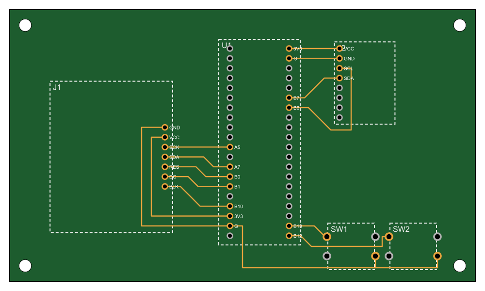

# Placa de circuito — face simples

Projeto KiCad 8: abra `pacman-tilt.kicad_pro`.



- **Tamanho:** 120 × 70 mm, 4 furos M3 nos cantos (para caixa ou espaçadores).
- **Cobre só na face de baixo (B.Cu)**, trilhas de **0,3 mm**, folga mínima de 0,25 mm (a menor folga real é 0,50 mm). Todos os componentes são de furo passante, montados por cima.
- **Sem jumpers:** nenhuma trilha cruza outra.

## Disposição

| Ref | Componente | Montagem |
|---|---|---|
| U1 | BlackPill STM32F411 | 2 barras fêmea 1×20, fileiras a 15,24 mm, **USB voltado para baixo** |
| J1 | Display ST7789 1,3" 240×240 | barra fêmea 1×7 na borda direita do módulo |
| J2 | MPU6050 (GY-521) | barra fêmea 1×8 |
| SW1 | Botão B (pausa) — PB13 | tátil 12 × 12 mm |
| SW2 | Botão A (confirma) — PB12 | tátil 12 × 12 mm |

Os botões usam os pinos em diagonal (pads 1 e 4), que estão sempre em lados diferentes da chave.

## Firmware para esta placa

Para as trilhas não se cruzarem, o display usa **DC no PB1 e RES no PB0**, que é o contrário da protoboard. Além disso, o módulo fica girado 180°. Grave com:

```bash
pio run -e pcb -t upload
```

Se a imagem aparecer de cabeça para baixo, troque `LCD_MADCTL` e `LCD_Y_OFFSET` no bloco `BOARD_PCB` de [include/config.h](../include/config.h).

## Antes de fabricar

- **Meça seus módulos.** Os contornos do display (31,6 × 39 mm) e do MPU (15,6 × 21,2 mm) são medidas típicas; o que importa para a placa são as posições dos furos. Confira na sua peça se a barra do display fica na borda maior.
- **Gere a placa pelo script:** `python hardware/gen_kicad.py` recria o esquemático, a placa e a prévia, e confere folgas e conectividade. Edite o script, não os arquivos gerados, se quiser mudar posições.
- No KiCad, rode **Inspecionar → Verificador de Regras (DRC)** antes de gerar os Gerbers ou imprimir a máscara para transferência térmica.
